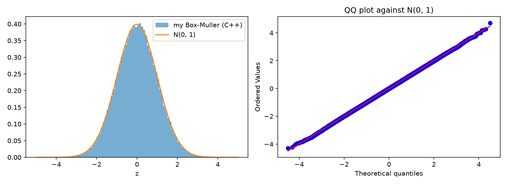
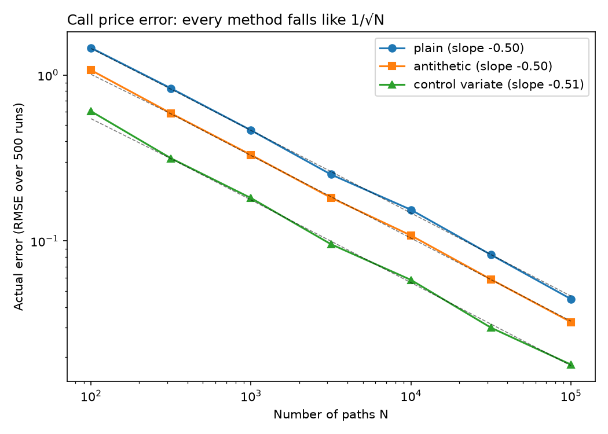

# Numerical methods in C++

My C++ work for computational finance, built from the bottom up: first the random numbers every simulation depends on, then a Monte Carlo option pricer that uses them.

## 1. Making normal random numbers from scratch

A computer can only really produce uniform random numbers, but almost every model in finance needs normal ones. The normal CDF has no formula to invert, so the usual trick for converting uniforms doesn't work directly.

The Box-Muller method gets around this by making two normals at once. Two independent normals form a round cloud around the origin, so any point in it can be described by a direction and a distance. The direction is uniform, so it's just 2πU₂, and the distance has a CDF that can be inverted, giving R = √(−2 ln U₁). Converting back with cos and sin gives two independent standard normals.

I tested ten million draws against C++'s built-in generator and against theory:

| | Mean | Variance | Skewness | Kurtosis | P(\|Z\|>2) | P(\|Z\|>3) |
|---|---|---|---|---|---|---|
| My Box-Muller | 0.0003 | 1.0000 | 0.0013 | 2.9996 | 0.0455 | 0.0027 |
| C++ built-in | 0.0000 | 1.0003 | 0.0011 | 2.9990 | 0.0455 | 0.0027 |
| Theory | 0 | 1 | 0 | 3 | 0.0455 | 0.0027 |

The tails are the real test, and they match to four decimal places. The kurtosis is 3, compared with 12.9 for hourly Bitcoin returns in my earlier project. One detail that matters: the uniform generator can return exactly 0, and ln 0 is −∞, so I use 1 − U, which never can.



## 2. A Monte Carlo option pricer

The price of an option is its average discounted payoff, where the average is taken in the "risk-neutral" world in which the stock grows at the risk-free rate r. So I simulate the stock price at expiry with the exact solution of geometric Brownian motion, S_T = S₀ exp((r − σ²/2)T + σ√T·Z), using my Box-Muller normals, work out the payoff on each path, and average.

### Checking it against exact prices

Each kind of option is its own class with its own payoff, and one pricing function handles all of them without knowing which it has. With a million paths (S₀ = K = 100, r = 5%, σ = 20%, one year):

| Option | Monte Carlo | Exact | Error in standard errors |
|---|---|---|---|
| Call | 10.4419 | 10.4506 | −0.59 |
| Put | 5.5790 | 5.5735 | +0.64 |
| Digital | 0.5321 | 0.5323 | −0.43 |

All three are well within two standard errors of the exact answer. The digital is a nice check in its own right: its price is the discounted risk-neutral probability of finishing in the money, about 56% here.

### Getting more accuracy from the same paths

Monte Carlo error only shrinks like 1/√N, so halving it takes four times the paths. I tried two ways of making each path count for more:

- **Antithetic variates:** use every normal twice, as Z and −Z. A path and its mirror image move in opposite directions, so their average is steadier.
- **Control variate:** the discounted stock price has an exact expected value, S₀. If my sample's average stock price comes out too high, my call price probably did too, so I correct for it using the regression slope between the two.

| | Call std. error | Worth | Put std. error | Worth |
|---|---|---|---|---|
| Plain | 0.0147 | 1× | 0.0087 | 1× |
| Antithetic | 0.0104 | 2.0× | 0.0066 | 1.7× |
| Control variate | 0.0056 | 6.9× | 0.0056 | 2.4× |

"Worth" means how many times more plain paths it would take to match the accuracy. The control variate does the work of almost 7 million plain paths with 1 million.

The put rows hold something I didn't expect: with the control variate, the call and put end up with exactly the same standard error. That's put-call parity holding path by path. A put's payoff is a call's payoff minus a straight line in the stock price, and the control variate removes everything that's a straight line in the stock price, so both are left with identical randomness. The put gains less only because it started with less to remove: it pays nothing when the stock finishes high, which is where most of the stock's variation is.

### Does the error really fall like 1/√N?

To check, I priced the call 500 times with fresh random numbers at each of seven path counts and measured the actual error against the exact price.



All three methods fall at the same rate, with fitted slopes of −0.50, −0.50 and −0.51, so variance reduction lowers the error by a constant factor without changing the rate. The dashed lines are the standard errors my pricer reported, and they sit right on the actual errors, which matters most in practice: with no exact answer to compare against, the standard error is all you have, and it can be trusted.

The one exception is the control variate with only 100 paths, where it reported an error about 10% smaller than the real one. The regression slope is estimated from the same small sample it then corrects, so it fits that sample's noise slightly too well. By 316 paths the gap has gone.

## Running it

```bash
mkdir -p build figures
clang++ -std=c++17 -O2 -Wall src/box_muller.cpp -o build/box_muller && ./build/box_muller
clang++ -std=c++17 -O2 -Wall src/mc_payoffs.cpp -o build/mc_payoffs && ./build/mc_payoffs
clang++ -std=c++17 -O2 -Wall src/mc_variance.cpp -o build/mc_variance && ./build/mc_variance
clang++ -std=c++17 -O2 -Wall src/mc_convergence.cpp -o build/mc_convergence && ./build/mc_convergence
python src/plot_samples.py
python src/plot_convergence.py
```

The headers in `src/` hold the shared pieces: `normals.h` (Box-Muller), `black_scholes.h` (exact prices), `payoffs.h` (option classes) and `estimators.h` (the three Monte Carlo estimators). Random seeds are fixed, so the numbers above are reproducible.
